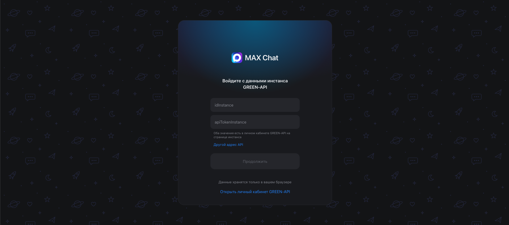
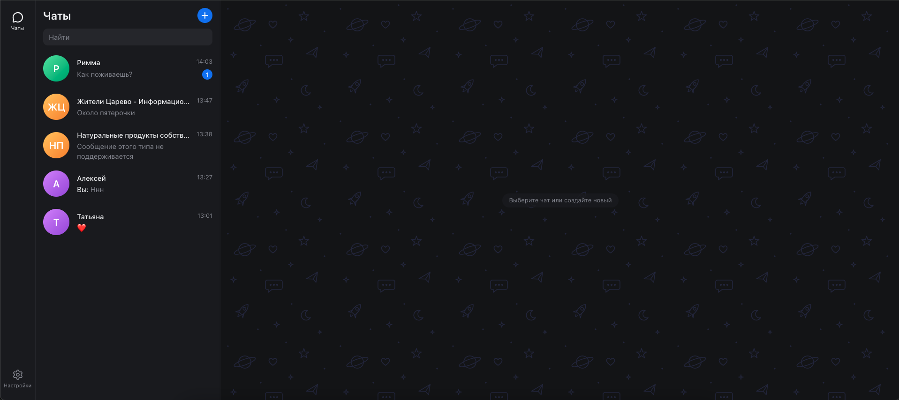
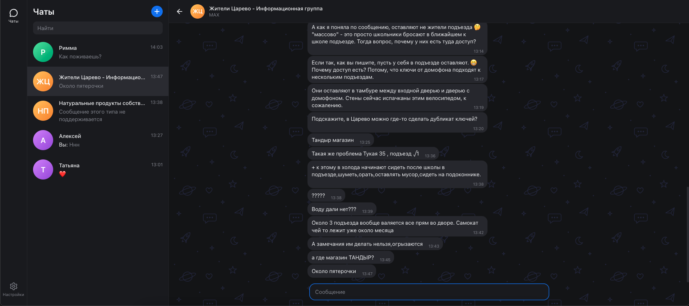

# MAX Chat

Веб-интерфейс для отправки и получения текстовых сообщений в мессенджере [MAX](https://max.ru) через сервис [GREEN-API](https://green-api.com/max). Внешний вид сделан по образцу [web.max.ru](https://web.max.ru).

Что умеет:

- вход по `idInstance` и `apiTokenInstance` из личного кабинета GREEN-API;
- создание чата по номеру телефона;
- отправка текстовых сообщений (метод [SendMessage](https://green-api.com/v3/docs/api/sending/SendMessage/));
- получение ответов через [HTTP API](https://green-api.com/v3/docs/api/receiving/technology-http-api/) (ReceiveNotification и DeleteNotification);
- статусы сообщений: отправлено, доставлено, прочитано, ошибка;
- переписка сохраняется в браузере и не пропадает после перезагрузки страницы;
- работает на компьютере и на телефоне.

## Запуск

### 1. Установить Node.js

Скачайте версию LTS с [nodejs.org](https://nodejs.org) (нужна 20.19 или новее) и установите с настройками по умолчанию.

Проверить установку можно в терминале. На Windows: `Win + R`, ввести `cmd`, Enter. На macOS: `Cmd + Пробел`, ввести «Терминал», Enter. Затем выполнить:

```bash
node -v
```

Должна появиться версия, например `v22.13.0`.

### 2. Скачать проект

Архивом: на странице [github.com/AlexeyBarsukov/GREEN-API](https://github.com/AlexeyBarsukov/GREEN-API) нажмите Code, затем Download ZIP, и распакуйте архив.

Или через git:

```bash
git clone https://github.com/AlexeyBarsukov/GREEN-API.git
```

### 3. Перейти в папку проекта

```bash
cd путь/к/папке/GREEN-API
```

Можно набрать `cd ` с пробелом и перетащить папку в окно терминала, путь подставится сам.

### 4. Установить зависимости

```bash
npm install
```

Обычно это занимает от одной до нескольких минут. На предупреждения `warn` можно не обращать внимания.

### 5. Запустить

```bash
npm run dev
```

В терминале появится адрес `http://localhost:5173/`, его нужно открыть в браузере. Остановить приложение: `Ctrl + C` в терминале.

## Как пользоваться

### Подготовка инстанса GREEN-API

1. В [личном кабинете GREEN-API](https://console.green-api.com) создайте инстанс для MAX.
2. На странице инстанса нажмите «Авторизовать» и отсканируйте QR-код в приложении MAX на телефоне.
3. В настройках инстанса включите уведомления, иначе ответы не будут приходить в чат:
   - о входящих сообщениях и файлах;
   - о сообщениях, отправленных с телефона;
   - о сообщениях, отправленных с API;
   - о статусах отправленных сообщений;
   - об изменении состояния авторизации аккаунта.

   Поле «Адрес отправки уведомлений (URL)» должно остаться пустым.
4. Скопируйте `idInstance` и `apiTokenInstance` со страницы инстанса.

### Вход

Введите `idInstance` и `apiTokenInstance` и нажмите «Продолжить». Приложение проверит, что инстанс авторизован, и откроет список чатов.

По умолчанию запросы идут на `https://api.green-api.com`. Если в личном кабинете у инстанса указан другой `apiUrl`, нажмите «Другой адрес API» и вставьте его.



### Новый чат

Нажмите синюю кнопку «+» рядом с заголовком «Чаты», введите номер получателя в любом формате (`+7 999 123-45-67`, `89991234567`) и нажмите «Создать чат». GREEN-API для MAX поддерживает номера России (+7) и Беларуси (+375).

Если вам напишут первыми, чат появится в списке сам, с отметкой о непрочитанных сообщениях.



### Переписка

Сообщение отправляется по Enter или кнопкой отправки, `Shift + Enter` переносит строку. Ответы появляются в чате автоматически, обычно в течение пары секунд.



### Выход

Настройки в левом нижнем углу, затем «Выйти из профиля». Переписка останется в браузере и появится снова после входа с тем же инстансом.

## Возможные проблемы

| Проблема | Решение |
|---|---|
| `node` или `npm` не найдены | Node.js не установлен, или терминал был открыт до установки. Перезапустите терминал. |
| Ошибка про версию Node.js при `npm install` | Нужна версия 20.19 или новее. |
| «Неверный idInstance или apiTokenInstance» | Скопируйте данные из личного кабинета заново, без пробелов. |
| «Инстанс не авторизован» | Отсканируйте QR-код на странице инстанса. |
| Сообщения уходят, но ответы не приходят | Проверьте настройки уведомлений инстанса и что URL уведомлений пустой. После сохранения настроек подождите около минуты. |
| «У этого номера нет аккаунта MAX» | Получатель не зарегистрирован в MAX. |
| Порт 5173 занят | Vite выберет другой порт, откройте адрес из терминала. |

## Для разработчиков

Стек: React 19, TypeScript, Vite, Redux Toolkit (RTK Query для запросов к API, listener middleware для получения уведомлений), CSS Modules, Biome, lucide-react.

| Команда | Описание |
|---|---|
| `npm run dev` | запуск для разработки |
| `npm run build` | проверка типов и сборка в `dist` |
| `npm run preview` | просмотр собранной версии |
| `npm run typecheck` | проверка типов |
| `npm run lint` | линтер |
| `npm run format` | форматирование |

В репозитории есть `pnpm-lock.yaml`, так что можно использовать и pnpm.

```
src/
  app/              store, хуки, listener middleware
  features/
    auth/           экран входа
    chats/          список чатов, создание чата, панель чата
    messages/       лента сообщений и поле ввода
    notifications/  получение и обработка уведомлений
    settings/       профиль и выход
    layout/         каркас и навигация
  shared/
    api/            клиент GREEN-API, типы, тексты ошибок
    lib/            форматирование дат и телефонов, localStorage
    ui/             общие компоненты
  styles/           CSS-переменные
```

Получение сообщений работает через long polling: ReceiveNotification держит запрос открытым, пока не придёт уведомление, после обработки оно удаляется через DeleteNotification и сразу отправляется следующий запрос. Если очередь пуста, API отвечает статусом 408, это нормальная ситуация.

В MAX идентификатор чата это числовой ID пользователя, а не номер телефона, поэтому при создании чата номер сначала проверяется методом [CheckAccount](https://green-api.com/v3/docs/api/service/CheckAccount/), который возвращает `chatId`.
